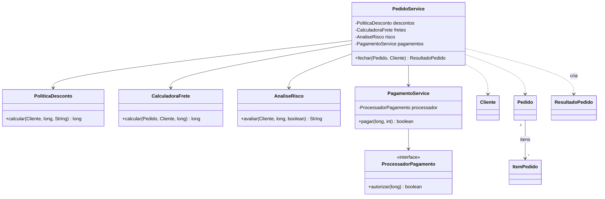
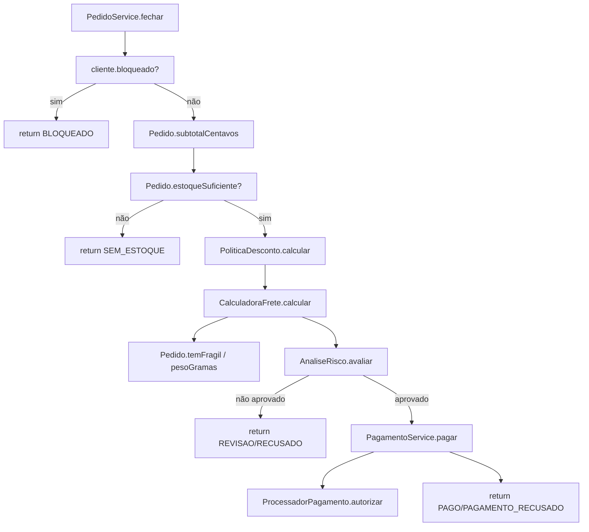
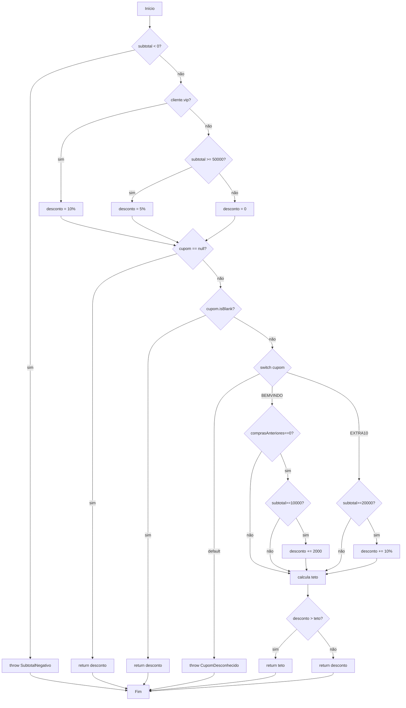
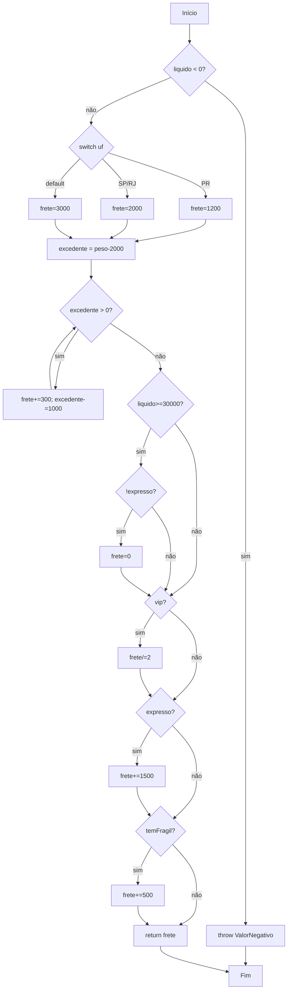
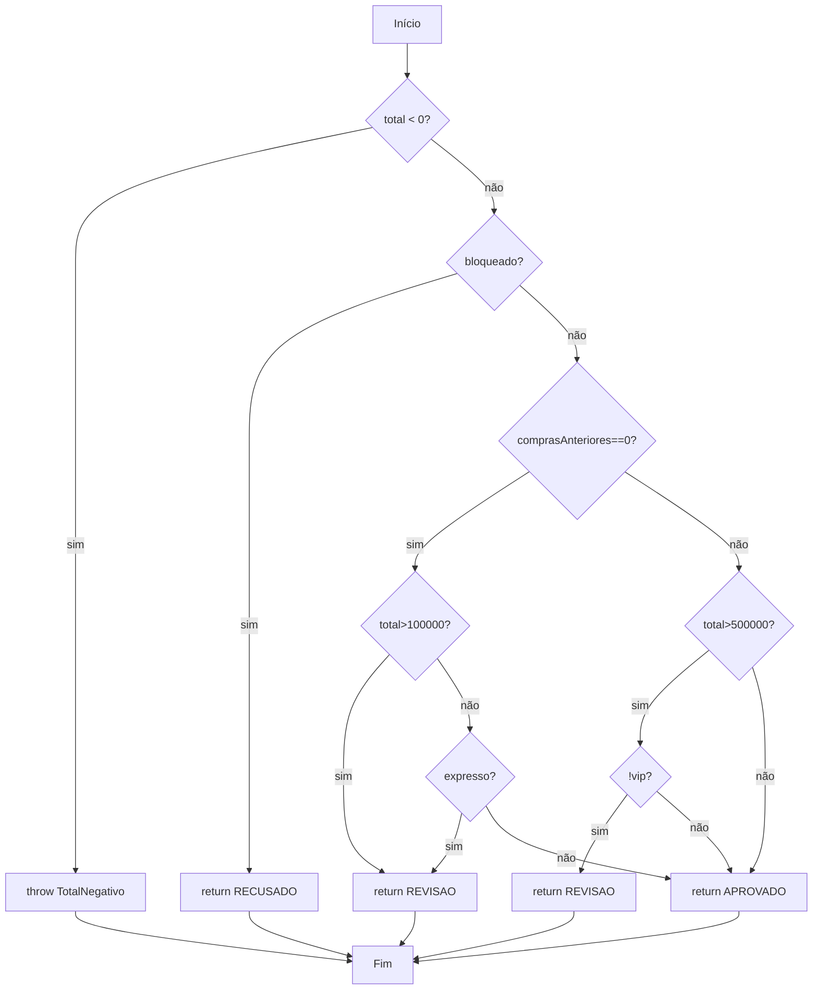
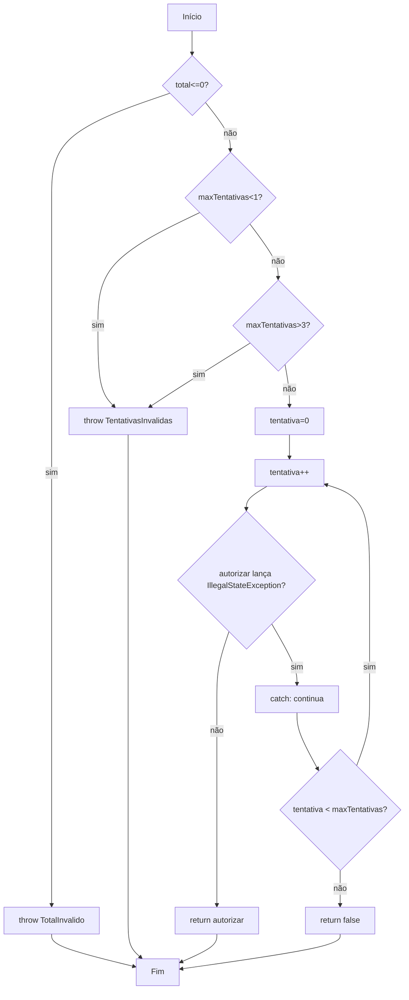
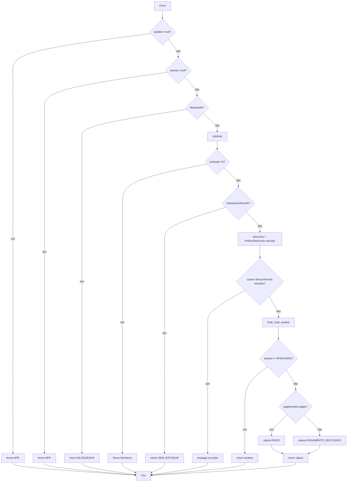

# Relatório do grupo

Integrantes: Sérgio

## Grafo de relacionamento entre classes

## Grafo de chamadas de `fechar`

Curto-circuito: nas condições com `&&`/`\|\|` (ex.: `AnaliseRisco`, `CalculadoraFrete`, `PoliticaDesconto`) cada operando foi modelado como um **nó de decisão separado**, pois o segundo operando só é avaliado se o primeiro não decidir o resultado — isso afeta diretamente a contagem de nós/arestas do CFG.

Exceções (`IllegalArgumentException`, `NullPointerException`, cupom desconhecido propagado) foram tratadas como **nós terminais que convergem para um nó de saída único** (`End`), permitindo aplicar `V(G) = E − N + 2` num grafo com entrada e saída unificadas.

---

## Grafos e complexidade

| Método | Nós (N) | Arestas (E) | V(G) = E−N+2 | V(G) = decisões+1 | Caminhos independentes propostos | Restrições de viabilidade |
| --- | --- | --- | --- | --- | --- | --- |
| `PoliticaDesconto.calcular` | 24 | 34 | 12 | 12 | 12 | Nenhuma restrição — todos os caminhos são alcançáveis via combinação de `vip`, `subtotal`, `comprasAnteriores` e `cupom`. |
| `CalculadoraFrete.calcular` | 21 | 29 | 10 | 10 | 10 | Nenhuma restrição — laço de peso exige valores de `pesoGramas` específicos (0, 1 e 3 iterações testados). |
| `AnaliseRisco.avaliar` | 14 | 20 | 8 | 8 | 8 | Todas as 8 combinações são alcançáveis **na unidade**. Na colaboração via `PedidoService.fechar`, o ramo `RECUSADO` (cliente bloqueado) é **inviável**, pois `fechar` já intercepta clientes bloqueados antes de chamar `avaliar` (ver análise crítica). |
| `PagamentoService.pagar` | 14 | 18 | 6 | 6 | 6 | Nenhuma restrição — o `do/while` permite 1 a 3 tentativas por contrato. |
| `PedidoService.fechar` | 23 | 30 | 9 | 9 | 9 | O caminho de exceção do cupom desconhecido (nó 14→15) depende de `PoliticaDesconto` propagar `IllegalArgumentException`; nenhuma restrição de inviabilidade. |

### CFG — `PoliticaDesconto.calcular` (V(G) = 12)

**Base de caminhos independentes → testes em `PoliticaDescontoTest`:**

| # | Caminho (resumo) | Teste JUnit |
| --- | --- | --- |
| 1 | subtotal < 0 → exceção | `deveLancarExcecaoQuandoSubtotalForNegativo` |
| 2 | vip, cupom nulo | `deveAplicarDescontoVipDeDezPorCento` |
| 3 | comum, subtotal ≥ 50000, cupom nulo | `deveAplicarDescontoDeCincoPorCentoParaComumComSubtotalAcimaDoLimite` |
| 4 | comum, subtotal < 50000, cupom nulo | `deveNaoAplicarDescontoParaComumComSubtotalAbaixoDoLimite` |
| 5 | cupom em branco | `deveIgnorarCupomEmBranco` |
| 6 | BEMVINDO elegível | `deveAplicarCupomBemVindoQuandoElegivel` |
| 7 | BEMVINDO ignorado (já comprou antes) | `deveIgnorarCupomBemVindoQuandoClienteJaComprouAntes` |
| 8 | BEMVINDO ignorado (subtotal < 10000) | `deveIgnorarCupomBemVindoQuandoSubtotalForMenorQueLimite` |
| 9 | EXTRA10 elegível | `deveAplicarCupomExtra10QuandoElegivel` |
| 10 | EXTRA10 ignorado | `deveIgnorarCupomExtra10QuandoSubtotalForMenorQueLimite` |
| 11 | cupom desconhecido → exceção | `deveLancarExcecaoParaCupomDesconhecido` |
| 12 | desconto combinado > teto → capado | `deveLimitarDescontoAoTetoDeVintePorcento` |

### CFG — `CalculadoraFrete.calcular` (V(G) = 10)

**Base de caminhos → testes em `CalculadoraFreteTest`:** liquido negativo (`deveLancarExcecaoQuandoLiquidoForNegativo`), UF PR/SP-RJ/default (`deveCobrarFreteBaseParaParana`, `deveCobrarFreteBaseParaSaoPauloERio`, `deveCobrarFreteBaseParaOutrasUfs`), 1 e 3 iterações do laço de peso (`deveAdicionarTaxaUnicaParaPesoExcedenteComFracao`, `deveAdicionarTaxaParaVariasIteracoesDePesoExcedente`), zerar frete (`deveZerarFreteQuandoLiquidoAtingirLimiteENaoForExpresso`), meia tarifa VIP (`deveAplicarMeiaTarifaParaClienteVip`), taxa expressa (`deveAdicionarTaxaExpressa`), taxa frágil (`deveAdicionarTaxaParaItemFragil`) e não zerar quando expresso (`naoDeveZerarFreteQuandoForExpressoMesmoComLiquidoAlto`).

### CFG — `AnaliseRisco.avaliar` (V(G) = 8)

**Base de caminhos → testes em `AnaliseRiscoTest`:** total negativo, bloqueado, novo cliente com total alto, novo cliente expresso, novo cliente aprovado, cliente antigo não-vip com total alto, cliente antigo vip com total alto, cliente antigo aprovado — os 8 testes já escritos cobrem 1:1 os 8 caminhos.

### CFG — `PagamentoService.pagar` (V(G) = 6)

**Base de caminhos → testes em `PagamentoServiceTest`:** total inválido, tentativas < 1, tentativas > 3, aprovação na 1ª tentativa (sem repetir), recusa definitiva sem repetir, sucesso após indisponibilidade temporária, esgotar tentativas com indisponibilidade — mais os testes extra de limite mínimo/máximo de tentativas e propagação de exceção não relacionada.

### CFG — `PedidoService.fechar` (V(G) = 9)

**Base de caminhos → testes em `PedidoServiceTest`:** pedido nulo, cliente nulo, bloqueado sem cobrança, subtotal zero, sem estoque (com cupom inválido ignorado), cupom desconhecido propagado, revisão sem cobrança, pago, pagamento recusado.

---

## Matriz de testes

| ID / método JUnit | Unidade | Entrada e estado do stub | Resultado esperado | Caminho / aresta | Critério atendido |
| --- | --- | --- | --- | --- | --- |
| `PoliticaDescontoTest.deveLimitarDescontoAoTetoDeVintePorcento` | `PoliticaDesconto` | vip, comprasAnteriores=0, subtotal=10000, cupom=BEMVINDO | 2000 (capado) | n21 (desconto>teto) = verdadeiro | Valor-limite (teto de 20%) |
| `CalculadoraFreteTest.deveAdicionarTaxaParaVariasIteracoesDePesoExcedente` | `CalculadoraFrete` | peso=4500g | 2100 (3 iterações) | a9→a10 (3x) | Laço com várias iterações |
| `CalculadoraFreteTest.naoDeveZerarFreteQuandoForExpressoMesmoComLiquidoAlto` | `CalculadoraFrete` | liquido=30000, expresso=true | 3200 (não zera) | a11(sim)→a12(não, pois expresso) | Curto-circuito `&&` — 2º operando decide |
| `AnaliseRiscoTest.deveColocarEmRevisaoNovoClienteComTotalBaixoMasExpresso` | `AnaliseRisco` | comprasAnteriores=0, total=1000, expresso=true | REVISAO | r7(não)→r8(sim) | Curto-circuito `\|\|` — 2º operando decide |
| `PagamentoServiceTest.deveRepetirAteSucessoQuandoIndisponibilidadeTemporaria` | `PagamentoService` | stub lança `IllegalStateException` na 1ª chamada, aprova na 2ª | `true`, 2 chamadas | p9(sim)→p11→p12(sim)→p8→p9(não)→p10 | Exceção controlada (não contada como branch pelo JaCoCo) |
| `PedidoServiceTest.deveRetornarSemEstoqueAntesDeValidarCupomDesconhecido` | `PedidoService` (colaboração) | estoque insuficiente + cupom inválido | `SEM_ESTOQUE`, sem exceção | f11(sim)→f12 | Ordem do contrato (retorno antecipado antes de avaliar cupom) |
| `PedidoServiceTest.devePropagarExcecaoDeCupomDesconhecidoQuandoEstoqueForSuficiente` | `PedidoService` (colaboração) | estoque ok + cupom inválido | `IllegalArgumentException` propagada | f14(sim)→f15 | Propagação de exceção entre camadas |

*(Tabela ilustrativa — os 90 testes cobrem coletivamente todos os caminhos listados nas seções de CFG acima.)*

---

## Evolução da cobertura

| Etapa | Testes executados | Linhas | Branches | Métodos | Classes | Lacunas e justificativas |
| --- | --- | --- | --- | --- | --- | --- |
| Inicial | 1 (exemplo fornecido) | ~5% | ~5% | ~11% | 9/9 (import) | Só um caminho de `PedidoService.fechar` exercitado; demais classes sem nenhum teste. |
| Fase 1 — entidades | 41 | — | — | — | — | `Cliente`, `ItemPedido`, `Pedido` cobrindo validações de construtor e métodos auxiliares. |
| Fase 2 — regras de negócio | 72 | — | — | — | — | `PoliticaDesconto`, `CalculadoraFrete`, `AnaliseRisco` → 100% linhas/branches nas 3 classes. |
| Fase 3 — pagamento e orquestração | **90** | **100%** | **100%** | **100%** | **9/9 (100%)** | `PagamentoService` e `PedidoService` completados; nenhuma lacuna de linha/branch alcançável restante. |

---

## Análise crítica

- **Quais combinações faltavam mesmo com os ramos cobertos?** O JaCoCo reporta 100% de branches, mas isso não comprova que toda **combinação multi-decisão** foi exercitada — por exemplo, em `CalculadoraFrete`, as flags `vip`, `expresso` e `temFragil` são decisões independentes (3 flags = 8 combinações), e testamos apenas combinações isoladas (uma flag ativa por vez), não todas as 8 combinações simultâneas.

- **Quais condições não foram avaliadas devido ao curto-circuito?** Em `AnaliseRisco.avaliar`, na expressão `total > 100_000 || expresso`, quando `total > 100_000` é verdadeiro, o operando `expresso` **nunca é avaliado** (o teste `deveColocarEmRevisaoNovoClienteComTotalAlto` usa `expresso=false` sem necessidade). Da mesma forma, em `CalculadoraFrete`, quando `liquido>=30000` é falso, `!pedido.expresso()` nunca é avaliado.

- **Quais caminhos são inviáveis no serviço, mas viáveis na unidade?** O ramo `RECUSADO` de `AnaliseRisco.avaliar` (quando `cliente.bloqueado()` é verdadeiro) é **viável isoladamente** (testado em `AnaliseRiscoTest.deveRecusarClienteBloqueadoIndependenteDoTotal`), mas **inviável via `PedidoService.fechar`**, porque `fechar` já retorna `"BLOQUEADO"` antes de chamar `risco.avaliar(...)` para qualquer cliente bloqueado — ou seja, `risco.avaliar` nunca recebe um `cliente.bloqueado()==true` quando chamado a partir do serviço.

- **Como foram testadas exceções e quantidades de iterações?** Exceções de validação (`IllegalArgumentException`, `NullPointerException`) foram testadas com `assertThrows` em cada classe. A exceção controlada de `PagamentoService` (`IllegalStateException`) foi testada com um stub baseado em `AtomicInteger` que conta chamadas e alterna entre lançar a exceção e retornar um resultado, cobrindo 0, 1 e 2 repetições. O laço de peso de `CalculadoraFrete` foi testado com 0 iterações (peso ≤ 2kg), 1 iteração com fração (peso 2,5kg) e 3 iterações (peso 4,5kg).

- **Qual alteração proposital foi detectada por qual teste? A alteração foi desfeita?** Alterei temporariamente o desconto VIP de `PoliticaDesconto.calcular` de 10% para 11% (`subtotal * 11 / 100`). O teste `PoliticaDescontoTest.deveAplicarDescontoVipDeDezPorCento` falhou imediatamente (`expected: <10000> but was: <11000>`), confirmando que a suíte detecta regressões nessa regra. A alteração foi **desfeita** e a suíte voltou a passar (90/90) com 100% de cobertura.
